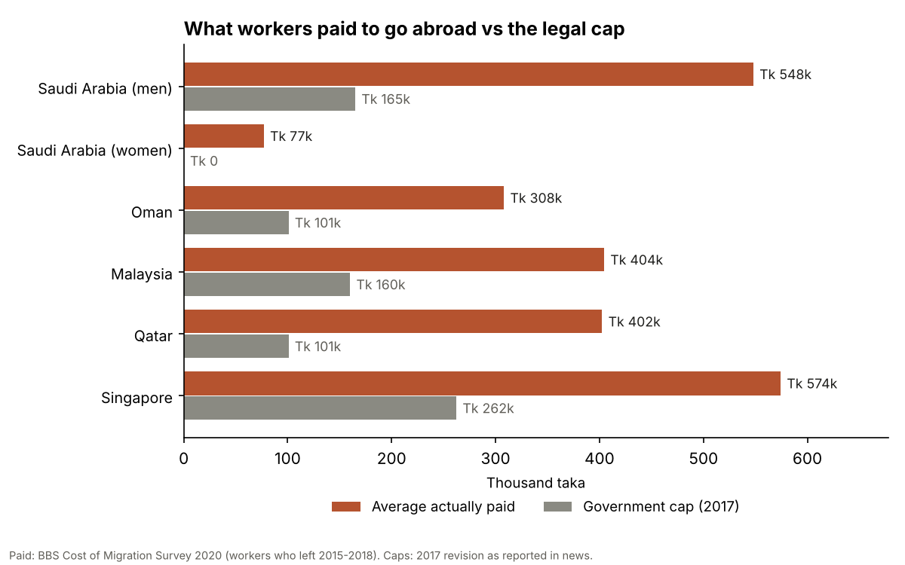

# migration-cost-explorer

[](https://doi.org/10.5281/zenodo.23752073)

What Bangladeshi workers actually pay to go abroad for work, compared with the legal caps the government sets on recruitment costs, by destination country, plus a calculator that shows one worker how long it takes to earn that cost back.



## Main finding

Workers who left Bangladesh between 2015 and 2018 paid **2 to 4 times the government's cap** on average, depending on the destination:

| Destination | Average paid | 2017 cap | Times the cap | Extra months of income |
|---|---|---|---|---|
| Saudi Arabia (men) | Tk 547,984 | Tk 165,000 | 3.3 | 17.3 |
| Saudi Arabia (women) | Tk 76,995 | Tk 0 | — | 3.5 |
| Oman | Tk 308,047 | Tk 100,780 | 3.1 | 10.8 |
| Malaysia | Tk 404,448 | Tk 160,000 | 2.5 | 10.2 |
| Qatar | Tk 402,478 | Tk 100,780 | 4.0 | 13.5 |
| Singapore | Tk 574,241 | Tk 262,270 | 2.2 | 8.2 |

"Extra months of income" is the amount paid above the cap divided by average monthly income in that country. Across all destinations, the average worker paid Tk 416,789, equal to 17.6 months of income, and 77.6% borrowed money to go.

## 1. The data

- `data/clean/survey_cost_by_destination.csv`: average cost (men, women, all), average monthly income and months of income needed to recover the cost, for the six destinations the survey reports separately. From the Bangladesh Bureau of Statistics' *Cost of Migration Survey 2020*, Tables 5.5 and 9.5.
- `data/clean/survey_borrowing_by_sex.csv`: how many workers borrowed to migrate (Table 5.9).
- `data/clean/fee_caps.csv`: the government's maximum migration cost for 16 destinations, with the source of every figure, including Malaysia's old and new caps.
- `data/clean/cap_vs_paid.csv`: the comparison above.

The survey report is a scanned document, so its tables were read with text recognition and then checked by eye against the page images. `code/02_check_survey.py` re-checks every number against the report's own arithmetic: months to recover equal cost divided by income, men's and women's figures add up to the totals, and the percentages match the counts.

## 2. The True Cost Calculator

**Use it here: https://affnann.github.io/migration-cost-explorer/**

A web page where a worker enters the destination, the total amount paid, how much was borrowed and at what monthly interest, the expected wage and monthly spending abroad. It shows how many months of work it takes to earn the cost back, the total cost with interest, how much more than the cap was paid, and what workers going to the same country paid on average. Nothing typed into the page is saved or sent anywhere.

The page is in `docs/`; the calculation is in `code/calc.js`. Each month the worker saves wage minus spending; savings first pay off the loan, with interest charged on what is still owed, and then earn back the part paid from the worker's own money. `code/calc.test.js` checks the calculation against hand-worked examples and the standard loan formula.

## Limitations

- **Caps come from news reports.** The government notices setting the caps could not be found online, so every cap is marked as reported in news (most from the minister's statement in parliament on the 2017 revision). Caps may have changed since; Malaysia's was reset to Tk 78,990 in 2022.
- **Timing.** Survey workers left in 2015–2018, while the caps used were revised in late 2017, so some workers left under earlier caps that could not be found.
- **Averages, not individuals.** The survey reports averages only. For Saudi Arabia, extra months are calculated with the average income of all workers there, because the survey does not report income by sex for each country.
- **Definitions differ slightly.** The survey counts every cost a worker paid to get the job and reach it; the caps set the maximum a worker may be charged. Both cover the full cost of migrating, but they were not written to match exactly.

## How to reproduce

```
python code/01_build_caps.py      # data file for the calculator page
python code/02_check_survey.py    # checks the survey numbers
python code/03_compare.py         # comparison table and chart
node code/calc.test.js            # checks the calculator
```

## Repository layout

```
code/      calculation, checks, comparison and chart scripts
data/      README with every source; clean/ holds the data files (CC BY 4.0)
docs/      the calculator web page
figures/   the chart above
```

## How to cite

Azom, Kazi Affnann (2026). *migration-cost-explorer* (v1.0.0). Zenodo. https://doi.org/10.5281/zenodo.23752073

To cite every version, use https://doi.org/10.5281/zenodo.23752072.

## License

Code: MIT (see `LICENSE`). Data compiled for this project: CC BY 4.0. Source documents keep their own terms.
